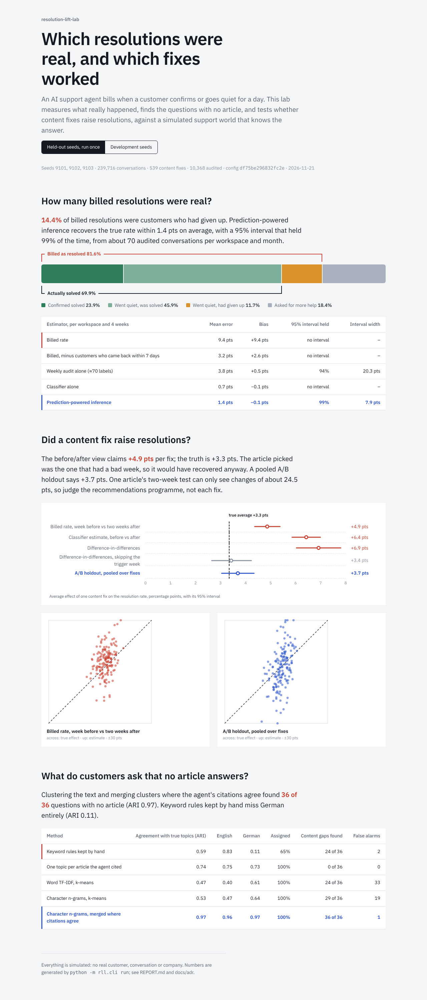
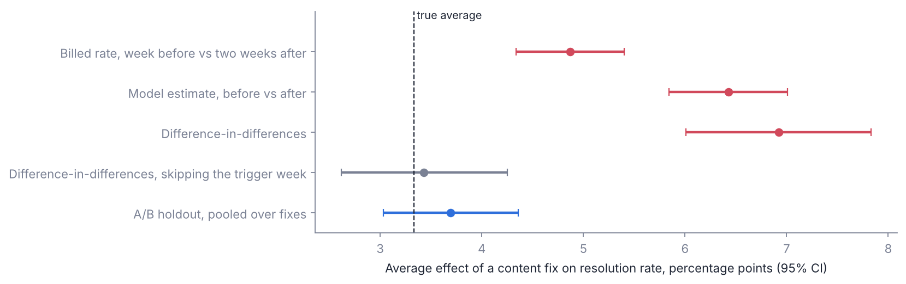
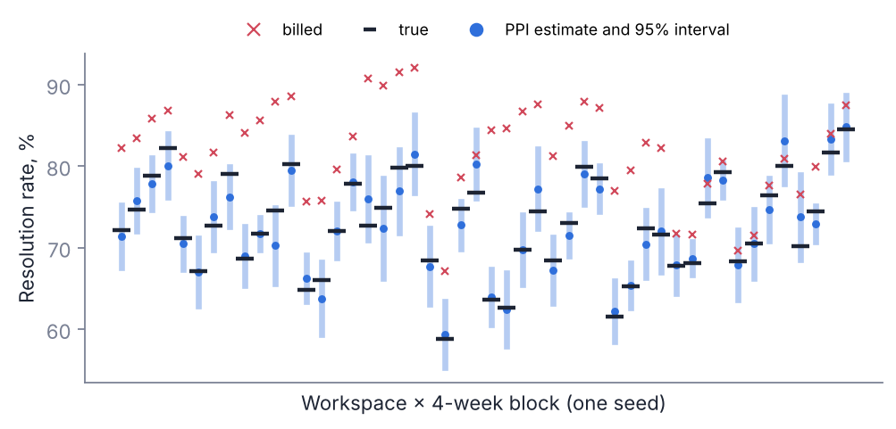

# resolution-lift-lab

Applied ML for an AI customer agent, graded against a world that knows the answer.

AI support agents are sold by outcome. Fin, for example, charges per resolution, and counts one when the
customer confirms *or* when they go quiet for a day after its last answer (an "assumed resolution").
Every week it recommends content fixes for conversations it could not answer. That raises three questions
that support logs cannot answer by themselves:

1. **How many billed resolutions were real?** A customer who gave up also goes quiet.
2. **Did a content fix raise resolutions?** The article that gets fixed is the one that just had a bad week,
   so it recovers anyway.
3. **What do customers ask that no article answers?** The agent answers those from the closest article, so
   they hide inside other topics.

This repository frames each one as an ML or statistics problem, builds the candidate methods, and grades
them on simulated support worlds where the truth is recorded: whether each conversation was solved, what
each fix really did, and which question has no article.



## Results

<!-- results:start -->
*held-out seeds, run once; generated 2026-11-21T17:05:52Z by `python -m rll.cli report`*

- **14.4% of billed resolutions were not real.** Billed rate 81.5%, true rate 72.0%. Prediction-powered inference recovers the true rate within 1.4 pts on average with a 95% interval that held 99% of the time, from about 70 audited conversations per workspace and month.
- **The status-quo before/after view overstates what content fixes do by 47%** (+4.9 pts claimed vs +3.3 pts true): the article picked was the one that had a bad week. A pooled A/B holdout gets +3.7 pts against a true +3.3 pts.
- **One article's two-week A/B can only detect a change of about 24.5 pts**, while a typical fix moves 3.3 pts. Judge the Recommendations feature with a pooled holdout, not fix by fix.
- **Content gaps:** clustering text and merging clusters where the agent's citations agree found 36 of 36 questions with no article (topic agreement ARI 0.97); hand-kept keyword rules reach ARI 0.11 on German conversations.

Seeds 9101, 9102, 9103 · 239,716 conversations · 539 content fixes · 10,368 audited conversations · config `df75be296832fc2e`

**How many billed resolutions were real** (true resolution rate per workspace and 4 weeks)

| Estimator | Mean abs. error | Bias | 95% interval holds | Interval width |
|---|--:|--:|--:|--:|
| Billed rate (status quo) | 9.4 pts | +9.4 pts | – | – |
| Billed, minus customers who came back | 3.2 pts | +2.6 pts | – | – |
| Weekly audit alone | 3.8 pts | +0.5 pts | 94% | 20.2 pts |
| Model alone | 0.7 pts | -0.1 pts | – | – |
| Prediction-powered inference (this repo) | 1.4 pts | -0.1 pts | 99% | 7.9 pts |

**Did a content fix raise resolutions** (true effect: change in resolution probability over 14 days)

| Design | Average effect claimed (95% CI) | True average | Fixes measured | Per-fix bias |
|---|--:|--:|--:|--:|
| Billed rate, week before vs two weeks after (status quo) | +4.9 pts (+4.3 pts to +5.4 pts) | +3.3 pts | 539 of 539 | +2.7 pts |
| Model estimate, before vs after | +6.4 pts (+5.8 pts to +7.0 pts) | +3.3 pts | 539 of 539 | +3.7 pts |
| Difference-in-differences | +6.9 pts (+6.0 pts to +7.8 pts) | +3.4 pts | 399 of 539 | +3.4 pts |
| Difference-in-differences, skipping the trigger week | +3.4 pts (+2.6 pts to +4.2 pts) | +3.2 pts | 335 of 539 | -0.3 pts |
| A/B holdout, pooled over fixes (this repo) | +3.7 pts (+3.0 pts to +4.4 pts) | +3.3 pts | 538 of 539 | +0.1 pts |

**What customers write about, and which questions have no article**

| Method | Agreement with true topics (ARI) | English / German | Conversations assigned | Content gaps found | False gap flags |
|---|--:|--:|--:|--:|--:|
| Keyword rules (status quo) | 0.59 | 0.83 / 0.11 | 65% | 24 of 36 | 2 |
| One topic per cited article | 0.74 | 0.75 / 0.73 | 100% | 0 of 36 | 0 |
| Word TF-IDF + k-means | 0.47 | 0.40 / 0.61 | 100% | 24 of 36 | 33 |
| Character n-grams + k-means | 0.53 | 0.47 / 0.64 | 100% | 29 of 36 | 19 |
| Character n-grams, merged by citations (this repo) | 0.97 | 0.96 / 0.97 | 100% | 36 of 36 | 1 |
<!-- results:end -->





## How it works

**The world** (`rll/world/sim.py`, `config/world.yml`, `config/topics.yml`). Twelve businesses in three
verticals (software, online shop, fintech), every third one writing in German, about 75,000 conversations
over 16 weeks. Each conversation has a first message built from topic templates with typos, an article the
agent cited (sometimes the wrong one), an answer-confidence score, and what the customer did next:
confirmed, went quiet, or asked for more. Solved customers mostly go quiet; so do some who gave up, more
in some businesses than others. A week later some customers come back about the same thing. Each business
has one topic with no article. Each Monday a content team fixes the article with the lowest resolution rate
last week; the fix's true effect varies and is sometimes negative. On day 63 the agent's model gets better
for everyone. A weekly audit records the truth for 18 random conversations per business.

**The methods** see only what a product would log (`Observed`).

| Question | Methods compared | Graded on |
|---|---|---|
| True resolution rate per business and 4 weeks | billed rate; billed minus returners; audit alone; classifier alone; prediction-powered inference | error, bias, 95% interval coverage and width |
| Effect of a content fix | before/after (billed and classifier); difference-in-differences; DiD skipping the trigger week; A/B holdout pooled over fixes | bias, per-fix RMSE, coverage, pooled average vs true average |
| Topics and content gaps | keyword rules; one topic per cited article; word and character TF-IDF with k-means; character clusters merged where citations agree | ARI and NMI vs true topics, gaps found, false alarms |

The classifier is a gradient-boosted model on behaviour signals, cross-fitted by business so its errors on
a business's audits are out of sample. Decisions and why are in [`docs/adr/`](docs/adr).

## Run it

```bash
pip install -e ".[dev]"
pytest -q                                   # ~5 s
python -m rll.cli run dev                   # three development worlds, ~3 min on 3 cores
python -m rll.cli gate dev                  # thresholds in config/gates.yml
python -m rll.cli report                    # REPORT.md, docs/figures, the block above
cd web && npm ci && npm run dev             # the dashboard
```

Held-out worlds (`python -m rll.cli run heldout`) run once: the first run writes `reports/heldout.lock`
and a second refuses. The gates were set on development worlds before that run.

## Limits

- **Everything is simulated.** The numbers show which method is right given the mechanisms built into the
  world (regression to the mean, a global model upgrade, customers who give up quietly, businesses that
  differ), not how large any effect is at a real company.
- Texts come from templates. Real conversations are longer and messier; a sentence-embedding model would
  likely beat TF-IDF on them, and was not used so that this runs in CI without downloads.
- One fix is too small to judge on its own here, with any design. The pooled holdout answers whether the
  recommendations programme works, not which fix to keep.
- The A/B view assumes the content team picks the same fixes whether or not a holdout runs.

## Sources

- [Fin outcomes and how they are measured](https://fin.ai/help/en/articles/13975800-fin-pricing-outcomes): assumed resolution after 24 hours of no reply.
- [Insights: CX Score, Topics Explorer, Recommendations](https://www.intercom.com/help/en/articles/10576273-measure-customer-service-with-insights-built-for-the-ai-agent-era).
- [Community thread: "Fin's flawed resolution assumption"](https://community.intercom.com/fin-product-feedback-member-group-49/fin-s-flawed-resolution-assumption-10516).
- Angelopoulos, Bates, Fannjiang, Jordan, Zrnic, *Prediction-powered inference*, Science 382 (2023).
